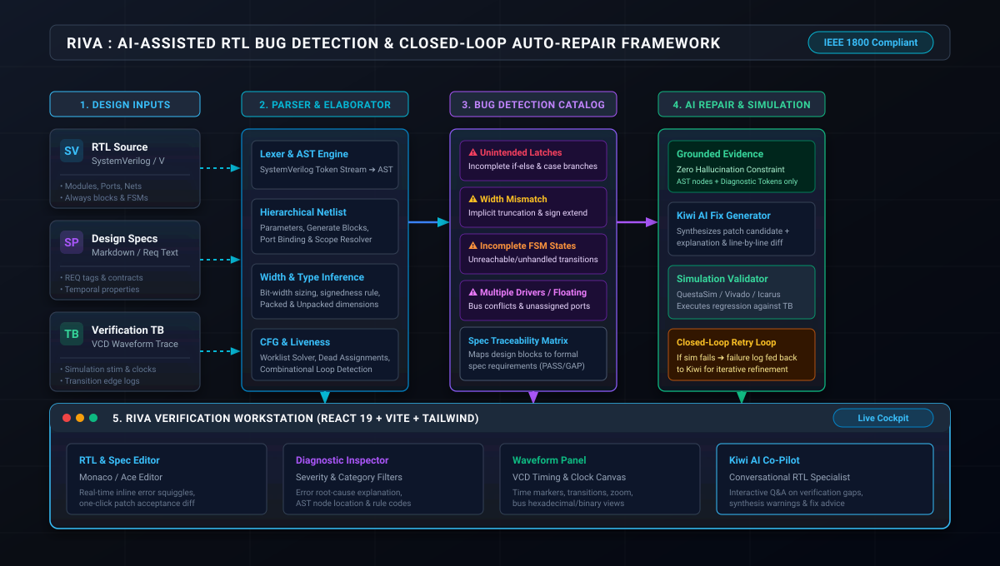
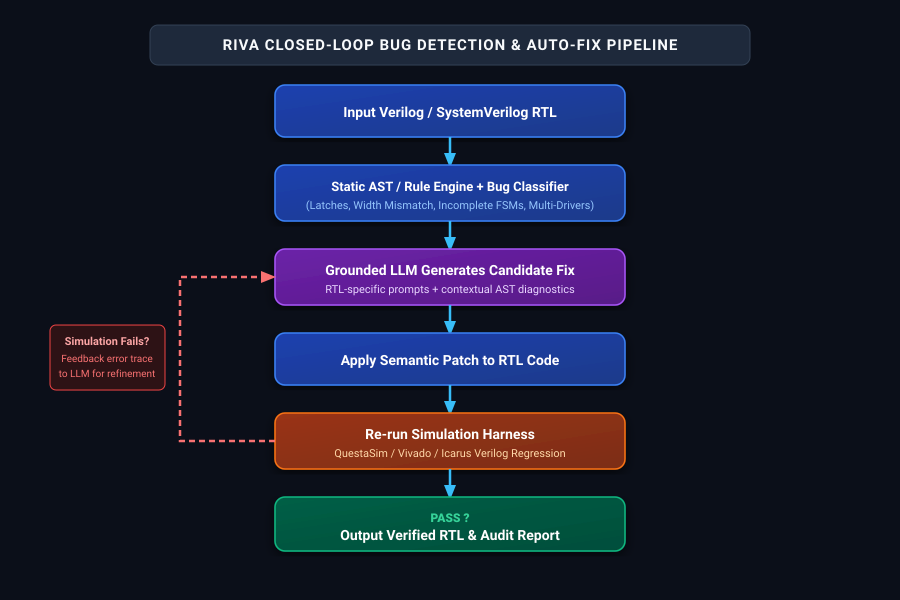

<div align="center">

# RIVA : AI-Assisted RTL Verification & Auto-Fix Framework

[](https://www.python.org/)
[](https://fastapi.tiangolo.com/)
[](https://react.dev/)
[](https://www.typescriptlang.org/)
[](https://vitejs.dev/)
[](#supported-systemverilog-subset)
[](https://opensource.org/licenses/MIT)
[](https://github.com/ilambharathim/AI_RTL_ASSISTANT/pulls)

**An industrial-grade, AI-augmented SystemVerilog verification cockpit with deterministic bug detection, grounded zero-hallucination auto-repair, and closed-loop simulation regression.**

[Architecture](#system-architecture) • [Workflow](#closed-loop-auto-fix-workflow) • [Key Features](#key-features) • [Repository Structure](#repository-structure) • [Quickstart](#getting-started) • [Academic Credits](#academic-credits)

---

</div>

## Overview

Register-Transfer Level (**RTL**) verification accounts for over **60-70% of modern digital design cycles**. Design engineers spend hundreds of hours manually inspecting VCD waveforms and tracing source code to diagnose subtle hardware defects—such as unintended latch inference, implicit bit-width truncation, incomplete finite-state machines, and bus driver conflicts.

**RIVA** bridges the gap between deterministic formal linting and modern generative AI:
1. **Deterministic Static & Semantic Analysis**: Constructs an IEEE 1800 SystemVerilog AST to reliably isolate hardware design bugs without false positives.
2. **Grounded AI Repair (Kiwi Assistant)**: Feeds verified AST slices and diagnostic tokens into an AI reasoning engine (Gemini / OpenAI / Anthropic / Local) under strict zero-hallucination constraints.
3. **Simulation-in-the-Loop Validation**: Re-runs golden testbenches using QuestaSim, Xilinx Vivado, or Icarus Verilog; if any assertion fails, failure logs are fed back into the AI engine for iterative repair.
4. **Interactive Workstation UI**: A futuristic React 19 workstation with Monaco code editors, VCD waveform timing canvases, requirement traceability matrices, and the interactive Kiwi engineering assistant.

---

## System Architecture

<div align="center">
  
</div>

### System Pipeline

```mermaid
flowchart LR
    subgraph Inputs["1. Design Inputs"]
        RTL["RTL Source<br/>(Verilog / SV)"]
        Spec["Design Spec<br/>(Markdown / Text)"]
        TB["Testbench &amp; VCD<br/>(Waveform Trace)"]
    end

    subgraph Core["2. Deterministic Core"]
        Lexer["SV Lexer &amp;<br/>AST Builder"]
        Elab["Hierarchy &amp;<br/>Netlist Elaboration"]
        Sem["Width &amp; Type<br/>Inference Engine"]
        CFG["CFG &amp; Liveness<br/>Dataflow Solver"]
    end

    subgraph Diag["3. Verification Catalog"]
        Linter["Rule Engine"]
        Linter --> B1["Latches"]
        Linter --> B2["Width Mismatch"]
        Linter --> B3["Incomplete FSM"]
        Linter --> B4["Multi-Drivers"]
        Trace["Requirement<br/>Traceability Matrix"]
    end

    subgraph Repair["4. Grounded AI &amp; Sim"]
        Evidence["Grounded Evidence<br/>(No Hallucination)"]
        Kiwi["Kiwi AI Auto-Fix<br/>(Code Patch Synthesis)"]
        Sim["Simulator Runner<br/>(Questa / Vivado / IV)"]
        Retry{"Pass ?"}
    end

    subgraph UI["5. Workstation Cockpit"]
        Editor["Monaco RTL Editor<br/>&amp; Patch Diff"]
        Wave["Interactive VCD<br/>Waveform Viewer"]
        Assistant["Kiwi Engineering<br/>AI Assistant"]
    end

    Inputs --> Core
    Core --> Diag
    Diag --> Evidence
    Evidence --> Kiwi
    Kiwi --> Sim
    Sim --> Retry
    Retry -- "No (Fail Trace)" --> Kiwi
    Retry -- "Yes (Verified)" --> UI
    UI -. "Interactive Inspect" .-> Inputs
```



---

## Closed-Loop Auto-Fix Workflow

When an RTL bug is detected, RIVA enforces a closed-loop validation cycle that guarantees only verified, functional patches reach the codebase:

<div align="center">
  
</div>

1. **Bug Detection**: Rule engine flags a structural defect (e.g. `WIDTH-001: 8-bit signal assigned to 4-bit register`).
2. **Evidence Packaging**: The precise AST node coordinates, symbol bit-widths, and surrounding scope are packaged.
3. **Patch Synthesis**: The Kiwi AI engine proposes a syntactically valid SystemVerilog patch with a concise root-cause explanation.
4. **Automated Regression**: The simulator automatically compiles the patched RTL and runs regression against the testbench.
5. **Pass / Retry**:
   - **PASS**: The unified diff is presented in the workstation for one-click merge.
   - **FAIL**: The simulator failure trace and assertion logs are passed back to Kiwi for iterative refinement (bounded retry loop).

---

## Key Features

| Capability | Description | Subsystem |
|---|---|---|
| **Deterministic Linting** | Catches unintended latches, missing `else`/`default` cases, incomplete FSM state graphs, and race conditions | `app/diagnostics/` |
| **Semantic Width Inference** | Strict IEEE 1800 bit-width sizing, signedness tracking, and implicit truncation warnings | `app/semantics/` |
| **Grounded AI Repair** | Anti-hallucination context sandbox generating surgical code patches with side-by-side diffs | `app/ai/` |
| **Kiwi Verification Co-Pilot** | Interactive AI assistant providing architectural feedback, synthesis insights, and bug explanations | `app/api/routes/kiwi.py` |
| **Simulation-in-the-Loop** | Native integration with QuestaSim, Xilinx Vivado, and Icarus Verilog with automated test regression | `app/simulation/` |
| **VCD Waveform Engine** | Fast waveform parser extracting signal state transitions, bus representations, and clock edges | `app/simulation/waveform_analyzer.py` |
| **Requirement Traceability** | Maps textual engineering specifications directly to synthesized RTL modules and ports | `app/analysis/traceability/` |
| **Futuristic Workstation UI** | React 19 + Tailwind workstation with split editors, waveform canvas, and diagnostic explorer | `frontend/` |

---

## Repository Structure

```text
AI_RTL_ASSISTANT/
├── assets/                                 # Flowcharts and architectural SVG diagrams
│   ├── riva_pipeline_flowchart.svg
│   └── riva_closed_loop_flowchart.svg
├── backend/                                # Python FastAPI Verification Backend
│   ├── app/
│   │   ├── ai/                             # Kiwi AI provider & grounded context engine
│   │   │   ├── kiwi_provider.py            # Multi-model LLM manager (Gemini/OpenAI/Anthropic)
│   │   │   ├── evidence_store.py           # Grounded evidence extraction (anti-hallucination)
│   │   │   └── grounding_validator.py      # Strict prompt constraint validator
│   │   ├── analysis/                       # Static analysis & CFG solvers
│   │   │   ├── cfg/                        # Control Flow Graph & basic block builder
│   │   │   ├── dataflow/                   # Liveness analysis & worklist solvers
│   │   │   ├── design_metadata_extractor.py# RTL module, port, and register metrics
│   │   │   └── traceability/               # Spec requirement to RTL mapping
│   │   ├── api/routes/                     # FastAPI endpoint controllers
│   │   │   ├── analyze.py                  # Core POST /api/analyze endpoint
│   │   │   └── kiwi.py                     # Interactive Kiwi AI chat endpoint
│   │   ├── ast/                            # Strongly typed SystemVerilog AST nodes
│   │   ├── diagnostics/                    # Lint rule catalog & severity classification
│   │   ├── parsers/rtl/                    # IEEE 1800 SystemVerilog lexer & parser
│   │   ├── repair/                         # Patch synthesizers & diff formatters
│   │   ├── semantics/                      # Type checking & bit-width inference passes
│   │   └── simulation/                     # Simulator runners (Questa/Vivado/IV) & VCD parser
│   ├── tests/                              # Comprehensive backend test suite (unit + extended)
│   └── main.py                             # FastAPI application entry point
├── frontend/                               # React 19 + TypeScript + Vite Workstation
│   ├── src/
│   │   ├── components/
│   │   │   ├── common/KiwiAssistantWidget.tsx # Floating interactive Kiwi AI co-pilot
│   │   │   ├── editor/                     # Monaco-based RTL & Spec editors
│   │   │   ├── layout/RivaShell.tsx        # High-tech workstation cockpit shell
│   │   │   ├── repair/                     # Interactive patch diff view & merge controls
│   │   │   ├── results/DesignOverviewPanel.tsx # RTL module hierarchy & synthesis summary
│   │   │   └── waveform/WaveformPanel.tsx  # Dynamic VCD timing diagram canvas
│   │   ├── services/api/apiService.ts      # REST API client
│   │   └── styles/                         # Custom Tailwind & dark workspace theme
├── docs/                                   # Architectural & specification documents
│   ├── architecture/                       # Subsystem deep dives (01-08)
│   ├── RIVA_PROJECT_CONTEXT.md             # Complete design specification
│   └── SYSTEMVERILOG_SUBSET.md             # Supported synthesizable grammar
└── README.md                               # Project documentation & quickstart
```

---

## Supported SystemVerilog Subset

RIVA supports the synthesizable subset of IEEE 1800-2017:

- **Modules & Interfaces**: `module`, `endmodule`, ANSI/non-ANSI port declarations (`input`, `output`, `inout`).
- **Data Types**: `logic`, `wire`, `reg`, packed arrays (`[MSB:LSB]`), signed & unsigned types.
- **Concurrent Constructs**: `assign` continuous assignments, module instantiations with named/positional port mappings.
- **Procedural Processes**: `always_comb`, `always_ff @(posedge clk or negedge rst_n)`, `always_latch`, `always @(*)`.
- **Conditionals & Branching**: `if-else`, `case`, `casez`, `casex`, `unique case`, `priority case`.
- **Generate Blocks**: `generate for`, `generate if-else`.
- **Parameters**: `parameter`, `localparam` with constant expression evaluation.

---

## Getting Started

### Prerequisites

- **Python**: `>= 3.10`
- **Node.js**: `>= 18.0` (npm `>= 9.0`)
- **RTL Simulator** *(Optional for live simulation)*:
  - [Icarus Verilog](http://iverilog.icarus.com/) (`iverilog`, `vvp`)
  - Siemens QuestaSim / ModelSim
  - AMD Xilinx Vivado Simulator (`xsim`)

---

### 1. Backend Setup

```bash
# Clone the repository
git clone https://github.com/ilambharathim/AI_RTL_ASSISTANT.git
cd AI_RTL_ASSISTANT/backend

# Create and activate Python virtual environment
python -m venv venv
# On Linux/macOS:
source venv/bin/activate
# On Windows (PowerShell):
.\venv\Scripts\Activate.ps1

# Install backend dependencies
pip install -r requirements.txt

# (Optional) Set your preferred AI Provider key for Kiwi
export GEMINI_API_KEY="your-api-key"
# or set OPENAI_API_KEY / ANTHROPIC_API_KEY

# Launch FastAPI development server
uvicorn app.main:app --host 0.0.0.0 --port 8000 --reload
```

The API documentation will be accessible at `http://localhost:8000/docs`.

---

### 2. Frontend Workstation Setup

```bash
# In a new terminal window:
cd AI_RTL_ASSISTANT/frontend

# Install dependencies
npm install

# Start the Vite development server
npm run dev
```

Open your browser at `http://localhost:5173` to access the **RIVA Verification Workstation**.

---

### 3. Running Verification & Audits

Run the backend verification test suite:

```bash
cd AI_RTL_ASSISTANT/backend
pytest tests/ -v
```

Execute the full RIVA acceptance suite:

```bash
cd AI_RTL_ASSISTANT/backend
python real_riva_acceptance.py
```

---

## Academic Credits

Developed as part of the **Project Based Learning (PBL)** curriculum at:

**Department of Electronics and Communication Engineering**  
**Chennai Institute of Technology (CIT)**, Chennai, Tamil Nadu, India.

- **Project Title**: AI-Assisted RTL Bug Detection and Auto-Fix Framework
- **Student Researchers**:
  - **Ilam Bharathi M** ([@ilambharathim](https://github.com/ilambharathim)) — *Department of ECE, CIT*
  - **Hariharan J** — *Department of ECE, CIT*
- **Faculty Mentor**:
  - **Mr. Rameshraja**, *Assistant Professor, Department of ECE, Chennai Institute of Technology*

---

## License

This project is licensed under the **MIT License** — see the [LICENSE](LICENSE) file for details.
