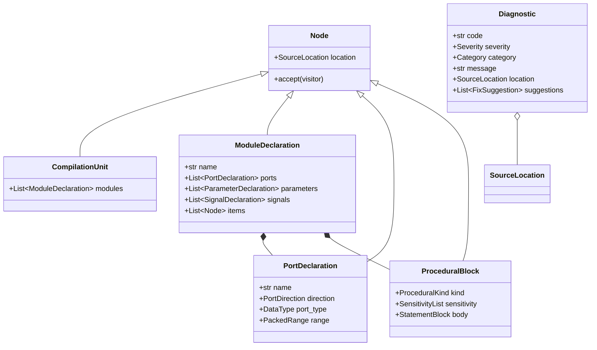

# 02 - Domain Model

## Core Entities & Representations

The RIVA backend models SystemVerilog designs using an immutable, strongly typed Abstract Syntax Tree (AST) augmented with semantic scopes and diagnostic evidence models.

## Entity Details

### 1. Abstract Syntax Tree (AST)
- **`ModuleDeclaration`**: Represents a hardware module containing interface definitions (ports, parameters) and internal behavior (nets, instances, processes).
- **`PackedRange`**: Defines MSB and LSB bit ranges (`[width-1:0]`) evaluated to constant integer boundaries during elaboration.
- **`ProceduralBlock`**: Categorized by block type (`always_comb`, `always_ff`, `always_latch`, `initial`). Contains sensitivity list tokens and child statement blocks.
- **`ContinuousAssign`**: Models concurrent wire assignments (`assign lhs = rhs;`).

### 2. Semantic Symbols & Scopes
- **`SymbolTable`**: Hierarchical lexical scope tracking identifiers, types, widths, drivers, and consumers.
- **`SignalSymbol`**: Tracks driving blocks, read locations, constant bounds, and clock domain association.

### 3. Diagnostic & Evidence Models
- **`Diagnostic`**: Immutable finding tagged with unique rule code (e.g., `LINT-001`, `WIDTH-003`, `FSM-002`), severity level (`ERROR`, `WARNING`, `INFO`), and precise file/line spans.
- **`EvidencePackage`**: Encapsulates verified code slices, diagnostic metadata, and simulation traces supplied to the AI repair engine.
