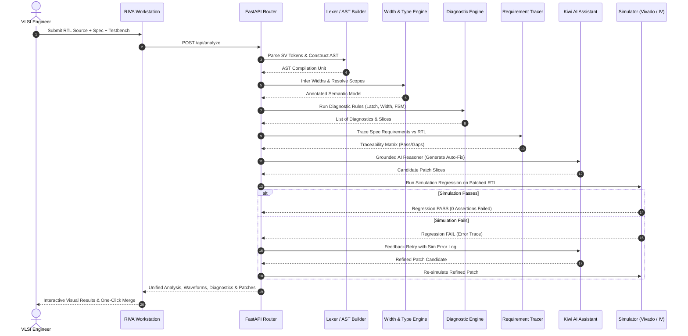

# 03 - Data Flow

## End-to-End Execution Pipeline

The execution flow within RIVA follows a deterministic pipeline from source ingestion to simulation-backed auto-repair.

## Data Payloads

1. **Request Payload (`/api/analyze`)**:
   - `code`: SystemVerilog HDL source text.
   - `spec`: Markdown / text design specification requirements.
   - `testbench`: Testbench HDL code or VCD trace data.
   - `options`: Severity thresholds, target simulator, and optimization passes.

2. **Analysis Result Payload**:
   - `diagnostics`: Array of categorized bugs with source locations, severity, and rule explanations.
   - `traceability`: Requirement coverage table linking specification paragraphs to RTL module instances.
   - `repairs`: Synthesized patches with code diffs, root-cause explanations, and confidence scores.
   - `waveform`: Signal transitions, timeline bounds, and bus values extracted from testbench VCD.
   - `metadata`: Module counts, port lists, flip-flop registers, and gate metrics.
